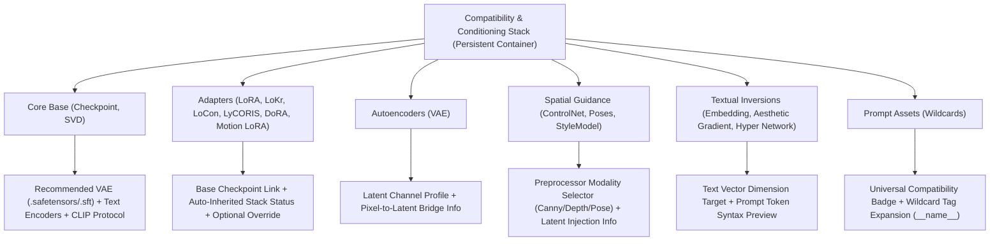

# SoloTensor Design System

## Aesthetic: Obsidian & Acid Lime Brutalist Studio
SoloTensor uses a disciplined, high-density AI creation studio aesthetic designed for professional solo artists and engineers. The atmosphere is defined by deep obsidian darkroom surfaces, hairline precision dividers, editorial display typography, and laser acid-lime status indicators.

---

## 1. Color System (Semantic Tokens)

All UI elements must consume semantic CSS variables or Tailwind tokens. Hardcoded hex values outside token definitions are prohibited.

The table below mirrors [`frontend/src/app/globals.css`](frontend/src/app/globals.css). That file is the authority — if the two ever disagree, the CSS wins and this table is a bug.

| Token | CSS Variable | Hex / Value | Semantic Role |
| :--- | :--- | :--- | :--- |
| `ground` | `var(--ground)` | `#0b0d0c` | Deep obsidian backdrop & base canvas ground |
| `surface` | `var(--surface)` | `#111411` | Sidebar rail, inspector panel, tool panels |
| `surface-raised` | `var(--surface-raised)` | `#181c18` | Cards, popovers, dropdowns, tooltips, active selections |
| `surface-soft` | `var(--surface-soft)` | `#242924` | Hover washes, secondary chips |
| `surface-sunken` | `var(--surface-sunken)` | `#080a09` | Textareas, text inputs, canvas frame background |
| `line` | `var(--line)` | `rgba(226,232,221,0.09)` | Hairline dividers, panel boundaries, idle borders |
| `line-strong` | `var(--line-strong)` | `rgba(226,232,221,0.18)` | Hover borders, emphasized dividers |
| `tray` | `var(--tray)` | `rgba(226,232,221,0.035)` | Floating dock / bezel backing |
| `core` | `var(--core)` | `rgba(15,18,15,0.96)` | Navigation rail and desktop shell core surface |
| `ink` | `var(--ink)` | `#f2f5ef` | Primary text |
| `ink-soft` | `var(--ink-soft)` | `#b0b8ad` | Secondary text |
| `ink-faint` | `var(--ink-faint)` | `#858e82` | Muted labels, idle nav icons |
| `accent` | `var(--accent)` | `#c7e36a` | Primary acid-lime accent, active pills, badges |
| `accent-hover` | `var(--accent-hover)` | `#d4ec87` | Interactive hover glow on buttons and toggles |
| `accent-ink` | `var(--accent-ink)` | `#12170d` | Deep high-contrast dark text/glyphs on lime accent |
| `accent-ambient` | `var(--accent-ambient)` | `rgba(170,205,80,0.14)` | Ambient accent bloom behind active elements |
| `success` | `var(--success)` | `#8fd6a2` | Success states |
| `warning` | `var(--warning)` | `#d8bd76` | Pending / caution states |
| `danger` | `var(--danger)` | `#ef8b80` | Error states, delete buttons, critical alerts |
| `danger-surface` | `var(--danger-surface)` | `rgba(210,80,67,0.12)` | Error banner background |
| `danger-line` | `var(--danger-line)` | `rgba(239,139,128,0.32)` | Error border highlight |

---

## 2. Typography & Hierarchy

### Display & Hero Headlines
- **Purpose**: Main empty states, hero titles, marquee copy (e.g., *"Give the model something to see."*).
- **Style**: Heavy, confident display typography with tight letter spacing (`font-sans font-bold tracking-tight text-neutral-100` or editorial serif accent).

### Technical Microcopy & Metadata
- **Purpose**: Section badges, character counts, status indicators, seed/dimension readouts.
- **Style**: Monospace uppercase with wide tracking:
  ```css
  font-mono text-[10px] tracking-widest text-[var(--ink-faint)] uppercase
  ```
  *Examples*: `WORKSPACE / 01`, `BLANK CANVAS`, `00 OUTPUTS`, `LOCAL`, `~28 SEC`.

### Interface Body & Control Labels
- **Purpose**: Parameter names, prompt inputs, tool descriptions, buttons.
- **Style**: Clean, highly legible sans-serif (`Inter` or `Geist`) at `text-xs` (12px) to `text-sm` (14px).

---

## 3. Layout & Spatial Geometry

- **Left Icon Rail (48px)**: Compact vertical navigation containing top app icon, route icons (Workspace, Tools, Models, Assets, Assist, Settings). Active route highlighted with a vertical acid-lime pill on the left border.

  The rail is part of the single-accent system: its surface is `var(--core)`, tooltips are `var(--surface-raised)`, idle icons are `var(--ink-faint)`, and every active/hover treatment derives from `var(--accent)`. The **Generate** item carries an extra flourish — a lime gradient fill with a corner pip when active, and a lime ambient aura with twinkling sparkles on hover. That flourish is geometry plus accent tokens only; it must never introduce a second palette. No hardcoded hex values belong in the rail.
- **Sticky Control Inspector (320px–360px)**: Left-aligned panel hosting mode tabs, prompt textareas, preset chips, aspect ratios, model loaders, and generation actions.
- **Main Canvas Viewport**: Expansive work area enclosed in a hairline frame (`border border-[var(--line)] rounded-xl bg-[var(--surface-sunken)]`). Features a top utility bar with live status dot (`Canvas ready`) and output counter (`00 OUTPUTS`).
- **Radius Scale**:
  - `rounded-md` (6px) for small chips, badges, and icon buttons.
  - `rounded-lg` (8px) for inputs, aspect-ratio selectors, and dropdowns.
  - `rounded-xl` (12px) for canvas frames, cards, and modal dialogs.
  - `rounded-full` for status dots and empty state icon badge.

---

## 4. Component Patterns

### Mode Tabs & Toggles
- Minimalist text tabs with an active acid-lime bottom border (`border-b-2 border-[var(--accent)] text-white`). Idle tabs stay muted (`text-[#8a8e87] hover:text-neutral-200`).

### Preset & Aspect Ratio Chips
- Muted outline buttons (`border border-[var(--line)] bg-[var(--surface)] text-[#8a8e87]`).
- Selected state activates a crisp lime border and text (`border-[var(--accent)] text-[var(--accent)] bg-[var(--accent)]/5`).

### Generation Action CTA
- High-visibility button with lightning icon and estimated duration:
  ```tsx
  <button className="flex w-full items-center justify-between rounded-lg bg-[var(--accent)] px-4 py-3 text-xs font-bold text-[var(--accent-ink)] hover:bg-[var(--accent-hover)] transition">
    <span>Generate image</span>
    <span className="font-mono text-[10px] opacity-80">⚡ ~28 SEC</span>
  </button>
  ```

---

## 5. Model Architecture & Compatibility Stack (Polymorphic Design)

The creation studio organizes AI assets into 16 standardized model types categorized into 6 functional tiers.

### Layout Stability Principle: Persistent Container
The **Compatibility & Conditioning Stack** panel in creation forms (`app/models/create/page.tsx`, and `EditModelDrawer` for existing models) must **always remain visible** to prevent cumulative layout shift (CLS) and maintain visual muscle memory. Instead of hiding the panel, the **internal components adapt polymorphically** to the active model type:



### Component Hierarchy by Model Tier

| Tier | Model Types | Internal Component Pattern | File Types Accepted |
| :--- | :--- | :--- | :--- |
| **Core Base** | `Checkpoint`, `SVD` | **Modular Conditioning Stack**: Dual-source VAE Selector + Text Encoder Dropdown + CLIP Architecture Selector. **Video variant (auto-detected)**: when the base architecture resolves to a video engine, the contextual banner becomes an acid-lime `[VIDEO BACKBONE · <ENGINE>]` pill and the same three selectors gain video quick-picks (`LTX23_video_vae_bf16`, `taeltx2_3`, CLIP `ltxv`). No toggle, no new type, no layout change — the container stays mounted. | `.safetensors`, `.sft`, `.ckpt`, `.gguf` |
| **Adapters** | `LoRA`, `LoKr`, `LoCon`, `LyCORIS`, `DoRA`, `Motion LoRA` | **Enclave Binding & Inheritance**: Base Model Gallery Link + Status Card indicating auto-inheritance of VAE/CLIP + Optional Manual Override Toggle | `.safetensors`, `.sft` |
| **Autoencoders** | `VAE` | **Latent Space Profile**: Latent channel format indicator (16ch FLUX vs 4ch SDXL) + Standalone encoder/decoder profile (no redundant VAE selector) | `.safetensors`, `.sft`, `.pt` |
| **Spatial Guidance** | `ControlNet`, `Poses`, `StyleModel` | **Preprocessor Mode Card**: Modality pill selector (Canny, Depth, OpenPose, Normal) + Tensor injection architecture info | `.safetensors`, `.pth`, `.bin` |
| **Textual Inversions** | `Embedding`, `Aesthetic Gradient`, `Hyper Network` | **Text Vector Binding**: Target token dimension info (768 CLIP-L / 2048 SDXL / 4096 T5) + Syntax helper (`embedding:name`) | `.safetensors`, `.pt`, `.bin` |
| **Prompt Assets** | `Wildcards` | **Universal Engine**: Universal compatibility badge + Wildcard token expansion format (`__name__`) | `.txt`, `.yaml`, `.json` |

### Model Type Badge Tokens
Model type badges in cards (`TensorModelCard`), filters, and drawers use distinct semantic pill tokens:
- **Base Models (`Checkpoint`, `SVD`)**: Acid lime accent outline with solid pill fill (`bg-[var(--accent)]/15 border-[var(--accent)] text-[var(--accent)]`).
- **Adapters (`LoRA`, `LoKr`, `DoRA`, etc.)**: Obsidian raised with cyber-cyan or lilac accent (`text-cyan-400 border-cyan-800/40 bg-cyan-950/20`).
- **VAEs (`VAE`)**: Warm amber border with sunken fill (`text-amber-400 border-amber-800/40 bg-amber-950/20`).
- **Guidance (`ControlNet`, `Poses`, `StyleModel`)**: Emerald/green indicators (`text-emerald-400 border-emerald-800/40 bg-emerald-950/20`).
- **Embeddings & Wildcards**: Monospace neutral outline (`text-neutral-300 border-[var(--line)] bg-[var(--surface-sunken)]`).

---

## 6. Absolute Anti-Patterns & Bans

- ❌ **No generic gradients or glassmorphism**: Avoid rainbow/purple gradient buttons and heavy backdrop blurs.
- ❌ **No hardcoded hex codes**: Never introduce arbitrary hex codes directly in components (`#ef8c79`, `#d5f06f`, etc.). Always reference semantic CSS variables (`var(--...)`) or Tailwind semantic color classes.
- ❌ **No layout shifts (CLS)**: Always reserve image aspect ratio boxes prior to asset load. Keep form panels mounted with polymorphic content rather than mounting/unmounting entire containers.
- ❌ **No apologetic empty states**: Frame empty states as intentional, instructional moments (e.g. *"Give the model something to see"*).
- ❌ **No self-referential inputs**: Never ask a user to select a VAE for a `VAE` model or a Text Encoder for `Wildcards`. Always adapt internal inputs to the active model type.

