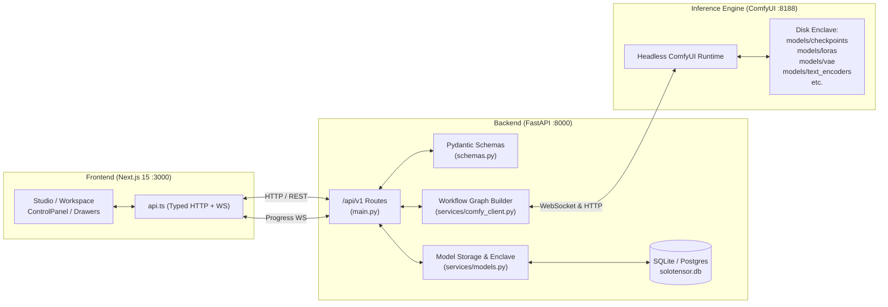
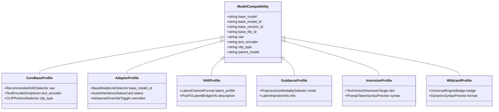
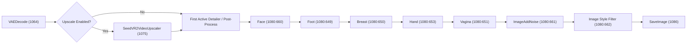

# SoloTensor System Architecture & Model Specification

This document provides the authoritative technical reference for SoloTensor's model taxonomy, dynamic conditioning stack, ComfyUI integration, and full-stack developer contracts across backend and frontend.

---

## 1. System Topology & Runtime Flow

SoloTensor is a local, privacy-first generative AI studio designed to bypass fragile node graphs while retaining complete ComfyUI engine power.



---

## 2. The 16 Model Types Specification

SoloTensor supports **strictly 16 model types** representing the complete modern generative diffusion ecosystem (including Flux, SDXL, SD3, Wan, and video pipelines).

### Complete Model Classification Matrix

| # | Model Type (`CreatorModelType`) | Tier | ComfyUI Directory | Allowed Extensions | Generation Role |
|---|---|---|---|---|---|
| 1 | **`Checkpoint`** | Core Base | `models/checkpoints/` | `.safetensors`, `.sft`, `.ckpt`, `.gguf` | Full / Modular generation backbone |
| 2 | **`SVD`** | Core Base | `models/checkpoints/` | `.safetensors`, `.sft`, `.ckpt` | Stable Video Diffusion core engine |
| 3 | **`LoRA`** | Adapter | `models/loras/` | `.safetensors`, `.sft` | Low-Rank Adaptation weight delta |
| 4 | **`LoKr`** | Adapter | `models/loras/` | `.safetensors`, `.sft` | Kronecker product adaptation |
| 5 | **`LoCon`** | Adapter | `models/loras/` | `.safetensors`, `.sft` | Convolutional-augmented LoRA |
| 6 | **`LyCORIS`** | Adapter | `models/loras/` | `.safetensors`, `.sft` | Extended multi-layer adapter library |
| 7 | **`DoRA`** | Adapter | `models/loras/` | `.safetensors`, `.sft` | Weight-Decomposed Low-Rank Adaptation |
| 8 | **`Motion LoRA`** | Adapter | `models/loras/` | `.safetensors`, `.sft` | Temporal / AnimateDiff motion adapter |
| 9 | **`VAE`** | Autoencoder | `models/vae/` | `.safetensors`, `.sft`, `.pt` | Latent ↔ RGB pixel encoder/decoder |
| 10 | **`ControlNet`** | Guidance | `models/controlnet/` | `.safetensors`, `.pth`, `.bin` | Spatial feature conditioning |
| 11 | **`Poses`** | Guidance | `models/poses/` | `.safetensors`, `.json`, `.png` | OpenPose & skeletal reference assets |
| 12 | **`StyleModel`** | Guidance | `models/style_models/` | `.safetensors`, `.bin` | CLIP vision style prompt adapter |
| 13 | **`Embedding`** | Inversion | `models/embeddings/` | `.safetensors`, `.pt`, `.bin` | Textual Inversion token vectors |
| 14 | **`Aesthetic Gradient`** | Inversion | `models/embeddings/` | `.safetensors`, `.pt`, `.bin` | Aesthetic scoring gradient vectors |
| 15 | **`Hyper Network`** | Inversion | `models/hypernetworks/` | `.safetensors`, `.pt` | Cross-attention network modifier |
| 16 | **`Wildcards`** | Prompt Asset | `models/wildcards/` | `.txt`, `.yaml`, `.json` | Dynamic prompt syntax expansions |

### Dual SafeTensors Extension Support (`.safetensors` & `.sft`)
Modern modular pipelines (e.g. Black Forest Labs FLUX.1 and Stability SD3) frequently package weights using the compact `.sft` extension (such as `ae.sft` for Autoencoders or `flux1-dev.sft`).

SoloTensor treats `.sft` as a first-class citizen alongside `.safetensors` across all validation, file uploading, local scanning, and workflow execution layers.

```python
# Defined in backend/app/services/models.py
MODEL_EXTENSIONS = {".safetensors", ".sft", ".ckpt", ".pt", ".pth", ".bin", ".gguf"}
```

---

## 3. Compatibility & Conditioning Stack Architecture

### Design Philosophy: Persistent Container, Polymorphic Slots
The **Compatibility & Conditioning Stack** panel (`Panel 1B` in `CreateModelDrawer.tsx`) must **always remain visible** to prevent jarring layout shifts (CLS) and keep the creation flow intuitive.

The internal contents adapt dynamically into one of 6 specialized component profiles based on the active `modelType`:



### Component Profile Details

#### Profile 1: Core Base Models (`Checkpoint`, `SVD`)
- **Use Case**: FLUX.1 Dev, SD3.5, Wan 2.1, SDXL, SD 1.5.
- **Controls Displayed**:
  - `Recommended VAE Decoder`: Dual-source scanner (`.safetensors` & `.sft`) with quick pills (`ae.sft`, `ae.safetensors`, `wan_2.1_vae.safetensors`) and manual filename input.
  - `Text Encoder File`: Dropdown for ComfyUI `models/text_encoders/` (e.g. `t5xxl_fp8_e4m3fn.sft`, `clip_l.safetensors`).
  - `CLIP Conditioning Type`: ComfyUI architecture protocol (`flux2`, `sdxl`, `sd3`, `wan`, `lumina2`, etc.).

#### Profile 2: Weight Adapters (`LoRA`, `LoKr`, `LoCon`, `LyCORIS`, `DoRA`, `Motion LoRA`)
- **Use Case**: Character LoRAs, Style LoRAs, AnimateDiff motion adapters.
- **Controls Displayed**:
  - `Exact Base Checkpoint Enclave Binding`: Select an installed gallery Base Model (`model_id:version_id:file_id`).
  - `Auto-Inherited Stack Status Card`: Visual notice informing the creator that VAE and CLIP protocols will be automatically resolved from whichever base checkpoint the user pairs it with at generation time.
  - `Optional Advanced Override`: Expandable toggle for rare edge cases where a LoRA mandates an unconventional VAE.

#### Profile 3: Autoencoders (`VAE`)
- **Use Case**: Latent compression weights (e.g. `ae.sft`, `sdxl_vae.safetensors`, `taesd.safetensors`).
- **Controls Displayed**:
  - `Latent Space Profile`: Latent channel format badge (e.g. 16-channel for FLUX/SD3, 4-channel for SD1.5/SDXL).
  - `Role Information`: Clarifies that this weights file acts as the primary image ↔ latent bridge with zero text encoder requirements.
  - *(Never displays a redundant "Select a VAE for this VAE" dropdown).*

#### Profile 4: Spatial & Guidance Models (`ControlNet`, `Poses`, `StyleModel`)
- **Use Case**: Canny, Depth, OpenPose, Normal map, Style Transfer pipelines.
- **Controls Displayed**:
  - `Conditioning Preprocessor Mode`: Modality selector (Canny, Depth, OpenPose, LineArt, Style).
  - `Latent Graph Information`: Confirms direct tensor guidance injection into the base model's diffusion iterations.

#### Profile 5: Textual Inversions (`Embedding`, `Aesthetic Gradient`, `Hyper Network`)
- **Use Case**: Negative prompt embeddings, face tokens, aesthetic style vectors.
- **Controls Displayed**:
  - `Target Embedding Space`: Indicates target text encoder vector dimension (768-dim CLIP-L vs 2048-dim SDXL dual-CLIP vs 4096-dim T5-XXL).
  - `Prompt Token Syntax Preview`: Live interactive badge showing invocation format (e.g. `embedding:name`).

#### Profile 6: Dynamic Prompts (`Wildcards`)
- **Use Case**: Randomized prompt text files (`colors.txt`, `styles.txt`).
- **Controls Displayed**:
  - `Universal Architecture Badge`: Validates that wildcard lists operate across all base models and inference pipelines.
  - `Wildcard Expansion Format`: Shows the token syntax (`__filename__`).

---

## 4. Backend Implementation Reference

### Key Modules & Files

| Module | Location | Core Responsibilities |
| :--- | :--- | :--- |
| **Schemas** | [`backend/app/schemas.py`](backend/app/schemas.py) | `CreatorModelType` enum, `ModelCompatibility` Pydantic model with validation, generation parameters. |
| **Model Storage** | [`backend/app/services/models.py`](backend/app/services/models.py) | `LOCAL_MODEL_CATEGORIES`, `MODEL_EXTENSIONS`, disk scanning (`local_models()`), import, installation, and database synchronization. |
| **Comfy Client** | [`backend/app/services/comfy_client.py`](backend/app/services/comfy_client.py) | Dynamic ComfyUI prompt graph building (`build_gallery_workflow()`, `build_lora_workflow()`), model name resolution, fallback `extra_pnginfo` injection. |
| **API Controller** | [`backend/app/main.py`](backend/app/main.py) | FastAPI endpoints for `/api/v1/models/local`, `/api/v1/models/{category}`, `/api/v1/clip-options`, `/api/v1/workflow/template-info`. |

### Dual-Source Enclave Scanning Pattern
When enumerating available VAEs or text encoders, the backend supports both filesystem-based inspection (via `COMFY_MODEL_ROOT`) and HTTP-based inspection (via live ComfyUI `/models/{category}`):

```python
# In backend/app/main.py
MODEL_CATEGORIES = {
    "checkpoints", "diffusion_models", "loras", "vae",
    "text_encoders", "embeddings", "hypernetworks",
    "controlnet", "poses", "wildcards", "style_models"
}

@app.get("/api/v1/models/{category}", response_model=list[str])
async def models(category: str) -> list[str]:
    return await get_comfy_client().list_models(category)
```

### Model Compatibility Validation Rule
In `ModelCompatibility` ([`app/schemas.py`](backend/app/schemas.py#L428)):
- `vae` is optional (`str | None`).
- `text_encoder` and `clip_type` are co-dependent: either both are provided, or both are `None`.
- `base_model_id`, `base_version_id`, and `base_file_id` must be set together when linking to an installed base model.

---

## 5. Frontend Implementation Reference

### Key Modules & Files

| Component | Location | Role |
| :--- | :--- | :--- |
| **API Client** | [`frontend/src/lib/api.ts`](frontend/src/lib/api.ts) | `CreatorModelType` union, `listLocalModels()`, `getModels()`, `getClipOptions()`, `uploadModelFile()`. |
| **Model Creation Drawer** | [`frontend/src/components/CreateModelDrawer.tsx`](frontend/src/components/CreateModelDrawer.tsx) | Step 1 Identity & Polymorphic Compatibility Stack, Step 2 Presets, Step 3 Multi-version Weights Upload. |
| **Generation Studio** | [`frontend/src/components/ControlPanel.tsx`](frontend/src/components/ControlPanel.tsx) | Base Model Selector (`Checkpoint`, `SVD`) and Active Adapter Slots (`LoRA`, `LoKr`, `DoRA`, etc.). |
| **Prompt Bar** | [`frontend/src/components/StudioPromptBar.tsx`](frontend/src/components/StudioPromptBar.tsx) | The single prompt surface for every `/generate` mode: positive prompt, optional one-line negative prompt, batch count, and the primary Generate action. |
| **Generation Model Card** | [`frontend/src/components/GenerationModelCard.tsx`](frontend/src/components/GenerationModelCard.tsx) | `GENERATION MODEL` card showing the selected checkpoint, its architecture chip, and the "Change" affordance that opens the model picker. |
| **Prompt Composer** | [`frontend/src/components/PromptComposer.tsx`](frontend/src/components/PromptComposer.tsx) | Multi-row prompt editor retained for the tool runner (`app/tools/[tool_id]/page.tsx`); not mounted in `/generate`. |
| **Model Card & Badges** | [`frontend/src/components/TensorModelCard.tsx`](frontend/src/components/TensorModelCard.tsx) | Visual card with tailored color badge tokens across all 16 types. |
| **Model Explorer** | [`frontend/src/app/models/page.tsx`](frontend/src/app/models/page.tsx) | Multi-category filter bar supporting all 16 model types. |

### Enclave Refresh & Parallel Discovery
The frontend calls both local disk scanner and live ComfyUI endpoints via `Promise.allSettled`, guaranteeing that files like `ae.sft` are instantly available regardless of deployment configuration:

```typescript
// Pattern in CreateModelDrawer.tsx
Promise.allSettled([
  api.listLocalModels("", "vae"),
  api.getModels("vae"),
]).then(([localRes, comfyRes]) => {
  const found = new Set<string>();
  if (localRes.status === "fulfilled" && localRes.value?.items) {
    localRes.value.items.forEach((x) => found.add(x.filename));
  }
  if (comfyRes.status === "fulfilled" && Array.isArray(comfyRes.value)) {
    comfyRes.value.forEach((x) => found.add(x));
  }
  setVaeFiles(Array.from(found));
});
```

---

## 6. Verification & Quality Assurance Commands

### Backend Verification
Run from `backend`:
```powershell
# Run the full test suite (324+ tests)
$env:PYTHONPATH='backend'; python -m unittest discover -s tests

# Run specific model and router tests
python -m unittest tests/test_models.py
python -m unittest tests/test_schema_validation.py
python -m unittest tests/test_img2img_generation.py
```
*Expected: `OK` (0 failures, 0 errors).*

### Frontend Verification
Run from `frontend`:
```powershell
# Typecheck
npx tsc --noEmit

# Production Build
npm run build
```
*Expected: All routes compiled with exit code `0`.*


---

## 7. Multi-Pass Generation Pipeline & Extensible Bypass Engine

SoloTensor includes a multi-stage post-processing pipeline for the `/generate` studio with dynamic ComfyUI graph pruning.

### Generation Workflow Matrix

The backend (`services/workflow_router.py`) selects the optimal ComfyUI workflow based on generation mode and flags:

| Active Features | Workflow Template | Processing Characteristics |
| :--- | :--- | :--- |
| **Image-to-Image** (`generation_mode == "image-to-image"`) | `workflows/workflow_generate_i2i.json` | Native ComfyUI Img2Img workflow (`LoadImage` 30, `VAEEncode` 32, `KSampler` 3 with native denoise, UNET/CLIP/VAE loaders, dynamic LoRA chaining). |
| **Base T2I** (`generation_mode == "text-to-image"`) | `workflows/workflow_generate_t2i.json` | High-fidelity pure base text-to-image pipeline with terminal SaveImage (1084). |
| **Upscale Pass** (SeedVR2 DiT) | `workflows/workflow_seedvr_upscaler.json` | Generative super-resolution pass (1.5x–4.0x) with LAB color correction. |
| **Detailer Pass** (ADetailer Multi-Target) | `workflows/workflow_detailer.json` | Cascading multi-target YOLO inpainting suite (Face, Hands, Body) with selective bypass pruning. |

### Sequential Cascade Architecture

In `workflow_generate_t2i.json`, inference flows through a sequential filter chain:



### Extensible Bypass Engine (`services/workflow_bypass.py`)
- **`BypassEngine`**: Generic, rule-based node pruning engine configurable via JSON (`config/bypass_rules.json`) or programmatically at runtime.
- **`apply_t2i_pipeline()`**: Re-links sequential image inputs so that any disabled pass (SeedVR2 or individual Face/Foot/Breast/Hand/Vagina detailers) is completely purged along with its auxiliary detector and pipe loader nodes, rewiring downstream inputs to the preceding active output with **zero broken node references**.
- **Parameter Injection**: Dynamic injection of user overrides for:
  - SeedVR2: Target resolution (calculated from scale factor), color correction mode (`lab`/`rgb`/`none`), input noise scale, and latent noise scale.
  - Detailers: Per-pass steps, CFG scale, denoise strength, bbox confidence threshold, bbox dilation, and custom detector models.

### Studio UI Components
- **`UpscalePanel.tsx`**: Multi-engine upscale controller supporting SeedVR2 DiT AI (with dynamic resolution preview) and Model/ESRGAN (4x-UltraSharp).
- **`DetailerPanel.tsx`**: ADetailer-inspired multi-pass manager featuring active basic model banner, quick-toggle target chips, and per-target accordion controls.

---

## 8. Multi-Tab Studio Architecture & State Isolation

For complete technical specifications on the `/generate` Studio page multi-tab system (`Text2Img`, `Img2Img`, `Edit`, `Video`, `Prime`), refer to the dedicated specification:
👉 [Generate Studio Multi-Tab Architecture](docs/generate_studio_architecture.md)

### Key Principles
1. **Isolated Tab State**: Each mode retains its own prompt, negative prompt, model selection, LoRAs, steps, CFG, denoise, and mode-specific parameters.
2. **Partitioned Storage**: Drafts persist per-mode under `solotensor:studio:draft:<mode>`.
3. **Graph Patching**: Backend dynamically switches between `EmptyLatentImage` (T2I), `LoadImage` + `VAEEncode` (I2I), and multi-stage cascades (Prime).

