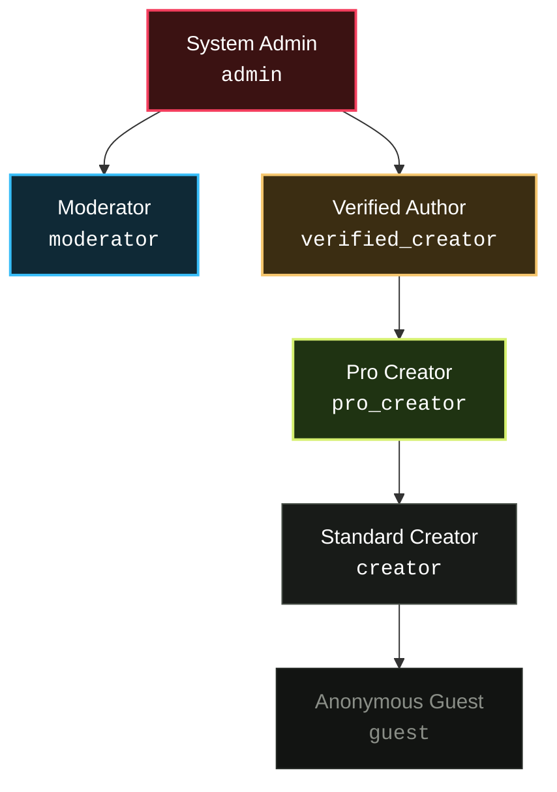
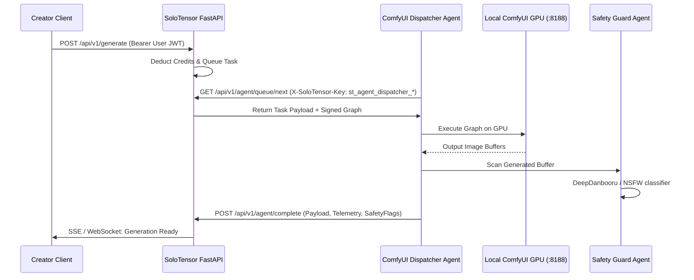
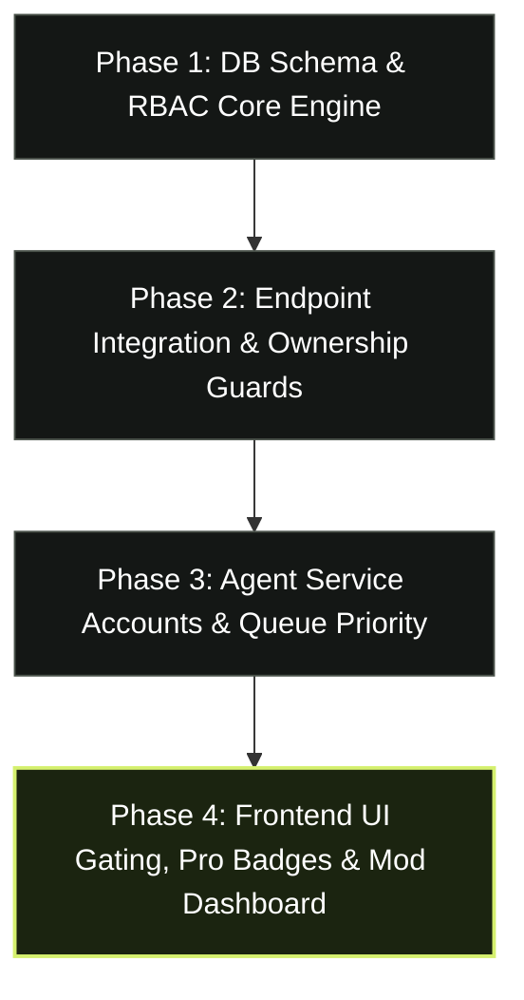

# SoloTensor RBAC Architecture & Implementation Plan
*Modeled after Tensor.art & Civitai Creator Platform Standards*

---

## 1. Executive Summary & Vision

To evolve SoloTensor from a local single-user studio into a high-density, multi-tenant creation network like **Tensor.art**, the platform requires a robust, scalable **Role-Based Access Control (RBAC)** architecture.

This design introduces:
1. **Tiered User Ecosystem**: Distinct capabilities for **Guest**, **Creator** (Free), **Pro Creator** (VIP), **Verified Creator** (Author), **Moderator**, and **System Admin**.
2. **Granular Permission Matrix**: Resource-level permission primitives (`resource:action`) governing models, generations, AI tools, queue priority, and hardware bounds.
3. **Backend Agent Security**: Dedicated service-account tokens and scoped keys for automated backend agents (ComfyUI Dispatcher, Content Safety Scanner, Credit Reconciler, Model Sync).
4. **Seamless Local-First Compatibility**: Defaults to zero-friction local operation while providing strict enforcement when multi-tenancy is active.

---

## 2. Tensor.art Role & Feature Comparison

| Feature / Dimension | Guest / Anonymous | Standard Creator (Free) | Pro / VIP Creator | Verified Creator | Moderator | System Admin |
| :--- | :--- | :--- | :--- | :--- | :--- | :--- |
| **Tensor.art Equivalent** | Unregistered Visitor | Free Registered User | Tensor.art Pro / Club Member | Verified Model Author / Partner | Community Mod | Staff Admin |
| **Daily Energy / Credits** | 0 (View only) | 100 / day (24h refill) | 500–1,000 / day + Rollover | 500 / day + Creator Revenue | 1,000 / day | Unlimited |
| **GPU Queue Priority** | N/A | Standard Queue | Fast-Lane Priority Queue | Fast-Lane Priority Queue | High Priority | Instant Realtime |
| **Model Publishing** | Read-only | Public Models (LoRA/CKPT) | Public + Private Drafts | Verified Badged Models + Download Controls | Edit/Hide Any | Full CRUD + Registry Control |
| **AI Tool Studio** | View & inspect tools | Create & run public tools | High-concurrency tool runs | Monetized / Premium tools | Moderate catalog | Direct graph injection |
| **Generation Privacy** | Public only | Public to gallery | Private generation toggle | Private toggle | Inspect all flags | Unrestricted |
| **Hardware Envelopes** | Standard bounds | 1024×1024, 30 steps, 1 LoRA | 2K / 4K upscale, 60 steps, 5 LoRAs | Unlocked resolution & steps | Unlocked | Unlocked |
| **API Keys / Automation** | None | 2 keys, 10 req/min | 10 keys, 60 req/min | 20 keys, 120 req/min | Internal Mod API | Service Account Agent Keys |
| **Badge / Profile Display** | None | `CREATOR` (Bronze) | `PRO` (Neon Acid Lime) | `VERIFIED AUTHOR` (Gold Star) | `MODERATOR` (Cyan) | `ADMIN` (Amber / Crimson) |

---

## 3. Role Hierarchy & Permission Primitives



### Granular Permission Primitives

Permissions follow the format `<resource>:<action>`:

```text
# Generations & Canvas
generation:create_standard    # Standard inference (up to 1024x1024, 30 steps)
generation:create_pro         # High-res, 2K/4K latent upscale, extended steps
generation:create_private     # Mark generation private (omit from community feeds)
generation:batch_multirun     # Run batch sizes > 1 (e.g. 4x concurrent synthesis)
generation:delete_own         # Delete owned outputs from disk and database
generation:delete_any         # Moderator override to delete violating generations

# Models
model:publish                 # Upload checkpoints, LoRAs, and sidecar recipes
model:download_weights        # Download model safetensors weights files
model:edit_own                # Update title, preview covers, tags of owned models
model:edit_any                # Moderator update of categories or tags
model:delete_own              # Soft delete / unpublish owned model
model:delete_any              # Moderator takedown of violating model

# AI Tools
tool:execute                  # Run visual pipelines
tool:publish                  # Export workflow graphs as interactive Studio Tools
tool:delete_own               # Remove personal tools
tool:delete_any               # Moderate catalog tools

# Credits & Monetization
credits:claim_daily           # Claim standard daily credit allowance
credits:transfer              # Tip creators for models or workflow recipes
credits:manage_billing        # Manage Pro subscriptions and invoices
credits:grant_manual          # Admin credit injection / refund

# Moderation & Governance
moderation:flag_content       # Submit user reports on violating assets/models
moderation:review_queue       # Access moderation dashboard and report queue
moderation:ban_user           # Suspend or shadowban user accounts
moderation:inspect_telemetry  # View inference prompts, IP address, and node logs

# System & Backend Agents
agent:dispatch_jobs           # Service account permission to pull jobs for ComfyUI
agent:sync_models             # Service account permission to scan filesystem weights
agent:audit_safety            # Automated NSFT/safety scanner callback
```

---

## 4. Backend Database Schema (PostgreSQL & SQLite)

To support dynamic RBAC, role assignment, and audit logs without breaking existing schema:

```sql
-- 1. Roles Definition Table
CREATE TABLE IF NOT EXISTS roles (
    name VARCHAR(50) PRIMARY KEY,
    display_name VARCHAR(100) NOT NULL,
    description TEXT,
    tier_level INT NOT NULL DEFAULT 1,  -- Higher level inherits lower
    badge_style JSONB DEFAULT '{}',     -- Tailwind styling & icon metadata
    created_at TIMESTAMP WITH TIME ZONE DEFAULT CURRENT_TIMESTAMP
);

-- 2. Granular Permissions Catalog
CREATE TABLE IF NOT EXISTS permissions (
    codename VARCHAR(100) PRIMARY KEY,
    category VARCHAR(50) NOT NULL,      -- 'generation', 'model', 'moderation', etc.
    description TEXT NOT NULL
);

-- 3. Role-Permission Mapping (Many-to-Many)
CREATE TABLE IF NOT EXISTS role_permissions (
    role_name VARCHAR(50) REFERENCES roles(name) ON DELETE CASCADE,
    permission_codename VARCHAR(100) REFERENCES permissions(codename) ON DELETE CASCADE,
    PRIMARY KEY (role_name, permission_codename)
);

-- 4. User Role Assignments (Supporting primary role + optional custom overrides)
CREATE TABLE IF NOT EXISTS user_roles (
    user_id UUID REFERENCES users(id) ON DELETE CASCADE,
    role_name VARCHAR(50) REFERENCES roles(name) ON DELETE CASCADE,
    granted_at TIMESTAMP WITH TIME ZONE DEFAULT CURRENT_TIMESTAMP,
    granted_by UUID REFERENCES users(id) ON DELETE SET NULL,
    expires_at TIMESTAMP WITH TIME ZONE NULL, -- Optional expiration for Pro trial
    PRIMARY KEY (user_id, role_name)
);

-- 5. Audit Log for Sensitive Actions
CREATE TABLE IF NOT EXISTS security_audit_logs (
    id UUID PRIMARY KEY DEFAULT gen_random_uuid(),
    actor_id UUID REFERENCES users(id) ON DELETE SET NULL,
    action VARCHAR(100) NOT NULL,
    resource_type VARCHAR(50) NOT NULL,
    resource_id VARCHAR(100) NOT NULL,
    details JSONB DEFAULT '{}',
    ip_address VARCHAR(45),
    created_at TIMESTAMP WITH TIME ZONE DEFAULT CURRENT_TIMESTAMP
);
```

---

## 5. Backend Implementation Architecture (FastAPI)

### 5.1 Security Dependencies & Decorators

FastAPI dependency injection provides high-performance permission checks with cached lookups:

```python
# backend/app/dependencies/permissions.py

from typing import Callable, List
from fastapi import Depends, HTTPException, status
from ..schemas import UserResponse
from ..routers.auth import get_current_user, get_optional_user
from ..services.rbac_service import get_rbac_service, RBACService

class RequirePermission:
    """Dependency enforcing a specific permission codename."""
    def __init__(self, permission: str):
        self.permission = permission

    async def __call__(
        self,
        user: UserResponse = Depends(get_current_user),
        rbac: RBACService = Depends(get_rbac_service),
    ) -> UserResponse:
        if not await rbac.has_permission(user.id, self.permission):
            raise HTTPException(
                status_code=status.HTTP_403_FORBIDDEN,
                detail=f"PERMISSION_DENIED: Requires '{self.permission}'"
            )
        return user

class RequireOwnerOrPermission:
    """Allows resource owners or users with a moderator override permission."""
    def __init__(self, override_permission: str):
        self.override_permission = override_permission

    def check(self, resource_owner_id: str, user: UserResponse, rbac: RBACService) -> bool:
        if str(user.id) == str(resource_owner_id):
            return True
        return rbac.has_permission(user.id, self.override_permission)
```

### 5.2 Scoped Endpoint Integration Example

```python
# backend/app/routers/models.py

@router.delete("/models/{model_id}")
async def delete_model(
    model_id: str,
    user: UserResponse = Depends(get_current_user),
    db: Database = Depends(get_db),
    rbac: RBACService = Depends(get_rbac_service),
):
    model = db.get_model(model_id)
    if not model:
        raise HTTPException(status_code=404, detail="Model not found")

    # Authorize: Must be creator of model OR possess 'model:delete_any' (Moderator)
    if str(model["user_id"]) != str(user.id) and not await rbac.has_permission(user.id, "model:delete_any"):
        raise HTTPException(status_code=403, detail="FORBIDDEN_NOT_OWNER_OR_MODERATOR")

    db.delete_model(model_id)
    return {"success": True, "deleted": model_id}
```

---

## 6. Backend Agents & Service Accounts Architecture

In SoloTensor, automated processes require API access without browser sessions. These are configured as **System Service Accounts**:



### Service Account Roles

1. **`agent:dispatcher`**:
   - Authorized via dedicated key: `st_agent_dispatcher_xxxxxxxx`
   - Permissions: `agent:dispatch_jobs`, `generation:complete_any`
   - Scope: Cannot initiate billing, edit user accounts, or delete models.
2. **`agent:safety_scanner`**:
   - Permissions: `agent:audit_safety`, `moderation:flag_content`
   - Scans generated buffers and automatically flags or categorizes NSFW ratings.
3. **`agent:model_sync`**:
   - Permissions: `agent:sync_models`, `model:publish`
   - Synchronizes physical `.safetensors` files from disk checkpoints with database records.

---

## 7. Frontend User Experience & UI Indicators

### 7.1 Dynamic Role Badges
In user profiles and navbar dropdowns, roles display with custom brutalist styling:

- **Creator (Default)**:
  `border border-[#383d38] bg-[#181b18] text-[#8a8e87]` — `CREATOR`
- **Pro / VIP**:
  `border border-[var(--accent)] bg-[var(--accent)]/10 text-[var(--accent)] shadow-[0_0_12px_rgba(213,240,111,0.2)]` — `⚡ PRO`
- **Verified Author**:
  `border border-[#664d1a] bg-[#3b2d12] text-[#f5c66e]` — `★ VERIFIED AUTHOR`
- **Moderator**:
  `border border-[#0c4a6e] bg-[#082f49] text-[#38bdf8]` — `🛡 MODERATOR`
- **Administrator**:
  `border border-[#881337] bg-[#4c0519] text-[#fb7185]` — `⚙ ADMIN`

### 7.2 Graceful Feature Gating
- Fast-Lane Queue: Pro users see `Priority Queue: Active ⚡ (~4s avg)` while standard users see standard estimated times.
- Hardware Envelopes: Exceeding 1024×1024 or 35 steps presents a refined modal: *"Unlock 4K synthesis & batch pipelines with SoloTensor Pro"*.
- Moderation Affordances: Moderators and Admins viewing any model or post see an inline `[Mod Tools]` toolbar with direct Takedown, NSFW Flag, and Audit Log actions.

---

## 8. Phased Implementation Roadmap



### Phase 1: DB Schema & Core RBAC Engine (Backend)
- Create migration script in `backend/app/db.py` to create `roles`, `permissions`, `role_permissions`, and `user_roles`.
- Seed standard roles (`guest`, `creator`, `pro_creator`, `verified_creator`, `moderator`, `admin`) and baseline permissions.
- Implement `RBACService` with in-memory caching (TTL 5 minutes per user role set).

### Phase 2: Endpoint Integration & Ownership Guards (Backend)
- Upgrade `get_current_user` to attach active `roles` and `permissions` in `UserMeResponse`.
- Add `RequirePermission` and `RequireOwnerOrPermission` to `/api/v1/models`, `/api/tools`, and `/api/v1/gallery`.
- Enable soft-delete and moderation flag endpoints for community reporting.

### Phase 3: Agent Service Accounts & Priority Queue (Workers)
- Support prefix-scoped API keys: `st_agent_*` for internal agents and `st_live_*` for users.
- Add queue priority weighting in generation dispatcher (Pro tasks prioritized in ComfyUI prompt queue).

### Phase 4: Frontend UI Gating & Moderator Dashboard (Frontend)
- Update [`UserNavProfile.tsx`](file:///c:/Users/kenko/Desktop/priject/my-ai-generate/solotensor/frontend/src/components/UserNavProfile.tsx) and [`page.tsx`](file:///c:/Users/kenko/Desktop/priject/my-ai-generate/solotensor/frontend/src/app/user/[username]/page.tsx) with dynamic role badges.
- Create `/admin/moderation` dashboard route for moderators and admins.
- Add Pro upsell affordances for high-res generation parameters.
